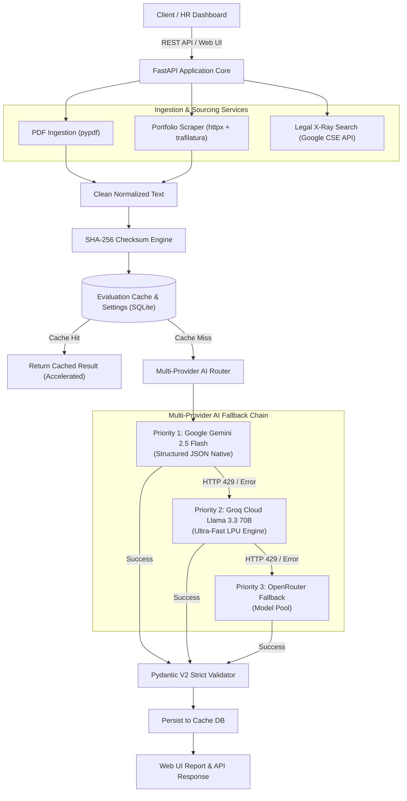

# Kayatix | A.Y.A.T. Engine

### Automated Yield for Applicant & Talent

[](https://www.python.org/)
[](https://fastapi.tiangolo.com/)
[](https://docs.pydantic.dev/)
[](https://github.com/astral-sh/uv)
[](https://getbootstrap.com/)
[](LICENSE)
[]()

---

## 🌟 About the Project

**Kayatix** (A.Y.A.T. Engine &mdash; *Automated Yield for Applicant & Talent*) is an enterprise-grade Human Resources Automation and Talent Intelligence platform designed for objective, data-backed candidate matching, deep portfolio analysis, and legal sourcing automation. Powered by **FastAPI**, **Pydantic V2**, **SQLAlchemy Async**, and a resilient **Multi-Provider AI Fallback Engine**.

---

## 📑 Table of Contents

1. [Core Features & Architecture](#1-core-features--architecture)
2. [Multi-Provider AI Fallback Cascade](#2-multi-provider-ai-fallback-cascade)
3. [Developer API Setup Guide & Credentials](#3-developer-api-setup-guide--credentials)
4. [System Installation & Quickstart (with uv)](#4-system-installation--quickstart-with-uv)
5. [Complete User & Operator Manual](#5-complete-user--operator-manual)
    - [5.1 Dashboard & Navigation](#51-dashboard--navigation)
    - [5.2 A.Y.A.T. Resume & LinkedIn PDF Screener](#52-ayat-resume--linkedin-pdf-screener)
    - [5.3 Deep Portfolio & Personal Website Analyzer](#53-deep-portfolio--personal-website-analyzer)
    - [5.4 100% Legal LinkedIn X-Ray Sourcing Engine](#54-100-legal-linkedin-x-ray-sourcing-engine)
    - [5.5 Evaluation History & SHA-256 Deduplication Cache](#55-evaluation-history--sha-256-deduplication-cache)
    - [5.6 Settings & Live Provider Diagnostics](#56-settings--live-provider-diagnostics)
6. [REST API Reference & cURL Examples](#6-rest-api-reference--curl-examples)
7. [Automated Testing Suite](#7-automated-testing-suite)
8. [Production Best Practices & FAQ](#8-production-best-practices--faq)

---

## 1. Core Features & Architecture

- **Universal Smart Search & Extraction (Zero Hardcoded Taxonomies)**:
    - Works dynamically for **ANY industry or job domain** (Marketing, Finance, Healthcare, Legal, HR, Operations, Sales, Engineering, Architecture, Culinary, etc.).
    - Extracts competencies directly from the Job Description using linguistic keyphrase parsing, acronym recognition (e.g. `SEO`, `GAAP`, `HIPAA`, `BLS/ACLS`, `FastAPI`), and delimited requirement scanning.
    - Evaluates candidates via **smart morphological stem matching** and **token coverage search**, eliminating rigid keyword mismatches.
- **Interval Union Sweep Algorithm (True YOE & Gap Detection)**:
    - Merges overlapping job tenures so concurrent roles do not artificially inflate candidate Years of Experience.
    - Accurately identifies transition gaps exceeding 180 days (~6 months) between consecutive career periods.
- **Domain-Agnostic Quantified Impact Detection**:
    - Scans for active accomplishment verbs across management, sales, finance, healthcare, and engineering alongside metric regexes (`%`, `$`, `€`, `revenue`, `team of 15`, `users`, `patients`).
- **Flexible 3-Tier Evaluation Strategy**:
    - **Hybrid Mode (Default & Recommended)**: Extracts candidate identity, skills, true YOE, and metrics locally in ~5ms with **0 tokens**, then issues a compact prompt to the LLM (Gemini &rarr; Groq &rarr; OpenRouter) as the **Source of Truth** for dynamic, role-tailored interview questions and executive synthesis. Saves ~90% quota while preventing HTTP 429 rate limits!
    - **100% Offline Local Engine**: Zero-quota, fully offline evaluation with deterministic scoring and template questions.
    - **Cloud LLM Cascade**: Full end-to-end multi-provider LLM processing.
- **100% Legal Candidate Sourcing (Zero Account Bans)**:
    - **Google X-Ray Search Engine**: Discovers public LinkedIn profiles via Google X-Ray Dorking with zero authenticated requests to LinkedIn servers. Features embedded zero-key CSE widget support and 1-Click direct Google search.
- **RAG Architecture & Grounded Chain-of-Thought Prompting**:
    - Preprocesses candidates through a 3-stage RAG pipeline (semantic chunking of skills, tenures, projects, and credentials).
    - Uses 5-stage Chain-of-Thought reasoning to audit genuine commercial software experience, respect Boolean alternatives (*"FastAPI or Django"*), calibrate 0-100 scores, and anchor interview questions in real candidate projects.
- **Deep Portfolio & Personal Website Analysis**: Asynchronously scrapes and strips boilerplate from candidate personal blogs, technical portfolios, and GitHub readmes using `httpx` and `trafilatura` with client-side SPA bundle discovery.
- **High Availability Multi-Provider AI Failover**:
    - Aggregates developer quotas across **Google AI Studio (Gemini 2.5 Flash)**, **Groq Cloud (Llama 3.3 70B)**, and **OpenRouter (Fallback Pool)**.
    - Transparently handles HTTP 429 rate limits and 503 spikes via circuit-breaker fallback logic.
    - **Active Provider Cache Validation**: SHA-256 caching with active provider verification and force refresh support.
- **Configurable Job Description Templates**:
    - Full CRUD management in **Settings &rarr; JD Templates** to create, edit, customize, copy, and delete standard job benchmarks for any industry or department.
    - Database-persisted with out-of-the-box defaults, instantly accessible via the **"Load Template"** dropdown inside both the Resume Screener and Portfolio Analyzer.
- **Universal Database Engine with Strict Resolution**:
    - Supports both local embedded **SQLite** and cloud **PostgreSQL** (Neon, Supabase, AWS RDS, Docker).
    - Strict resolution hierarchy: `.env` &rarr; system `os.environ` &rarr; local SQLite default.
    - Full password masking (`••••••••`) guarantees credentials never leak to the client browser.

---

## 2. Multi-Provider AI Fallback Cascade



---

## 3. Developer API Setup Guide & Credentials

To enable multi-provider AI resilience, obtain developer API keys from the following portals:

| Service                      | Model / Engine                          | Default Recommended Limits | Portal Link                                                                                                       |
| :--------------------------- | :-------------------------------------- | :------------------------- | :---------------------------------------------------------------------------------------------------------------- |
| **Google AI Studio**         | `gemini-2.5-flash`                      | 15 RPM, 1,500 RPD          | [Google AI Studio](https://aistudio.google.com/)                                                                  |
| **Groq Cloud**               | `llama-3.3-70b-versatile`               | 30 RPM, 14,400 RPD         | [Groq Console](https://console.groq.com/keys)                                                                     |
| **OpenRouter**               | `meta-llama/llama-3.1-8b-instruct:free` | Standard rotating pool     | [OpenRouter Keys](https://openrouter.ai/settings/keys)                                                            |
| **Google Custom Search API** | `Google Programmable Search`            | 100 queries / day          | [Google Cloud](https://console.cloud.google.com/) & [Search Engine](https://programmablesearchengine.google.com/) |

### Setting Up Google Custom Search (X-Ray Sourcing):

1. Navigate to [Programmable Search Engine](https://programmablesearchengine.google.com/) and create a new search engine.
2. Under **Sites to search**, add `linkedin.com/in/*` or select **Search the entire web**.
3. Copy the **Search engine ID** (`cx`) and set it into the app settings as `GOOGLE_CSE_CX_ID`.
4. Go to [Google Cloud Console](https://console.cloud.google.com/), enable the **Custom Search API**, generate an API Key, and set it as `GOOGLE_CSE_API_KEY`.

---

## 4. System Installation & Quickstart (with uv)

### Step 1: Clone the repository

```bash
git clone https://github.com/your-username/Kayatix.git
cd Kayatix
```

### Step 2: Create a Virtual Environment using `uv`

```bash
# Create virtual environment
uv venv

# Activate on Linux/macOS:
source .venv/bin/activate

# Or on Windows:
# .venv\Scripts\activate
```

### Step 3: Install Dependencies

```bash
uv pip install -r requirements.txt
```

_(Or install via pyproject.toml: `uv pip install -e .`)_

### Step 4: Launch the Kayatix Server

```bash
uvicorn app.main:app --host 0.0.0.0 --port 8000 --reload
```

> [!NOTE]
> **No `.env` file setup is necessary!** The application boots with functional SQLite defaults immediately. You can enter or modify your API keys at any time via the web settings interface at `http://localhost:8000/settings`.

---

## 5. Complete User & Operator Manual

### 5.1 Dashboard & Navigation

- Access the dashboard at **`http://localhost:8000/`**.
- **Top HR Analytics Metric Cards**: Live tracking of **Total Screened Candidates**, **Average Match Fit (%)**, **Qualified Shortlist (≥75%)**, and **Average Seniority (YOE)**, paired with a visual **Talent Pipeline Fit Distribution Bar**.
- **Quick-Access Launchpad**: Instant one-click routing to Screener, Portfolio Analyzer, X-Ray Sourcing, and Settings.
- **Recent Activity Table**: View candidate name, matched skills, overall score, provider used, and link directly to full reports.

---

### 5.2 Resume & LinkedIn PDF Screener

- **URL**: **`http://localhost:8000/screener`**
- **How to Use**:
    1. **Upload Resume**: Drag and drop any candidate PDF resume or LinkedIn profile export ("More..." > "Save to PDF").
    2. **Provide Job Description**: Paste target role criteria, or click one of the quick template presets:
        - _Senior Python / FastAPI Engineer_
        - _Lead Frontend Engineer (React/TypeScript)_
        - _DevOps / SRE Engineer_
    3. **Click "Run AI Evaluation"**:
        - The system extracts and sanitizes text via `pypdf`.
        - Generates a SHA-256 fingerprint of `(resume + JD)` to check the cache.
        - Routes to Google Gemini 2.5 Flash (or Groq failover if throttled).
        - Renders an interactive report card:
            - **Match Percentage** with color-coded gauge (Green for $\ge 75\%$, Yellow for $50-74\%$, Red for $<50\%$).
            - **Executive Fit Summary** written by the AI engine.
            - **Estimated Years of Experience**.
            - **Skill Badges**: Matched Skills (Green) vs Missing Critical Skills (Red).
            - **Detected Projects & Quantified Impact**: Highlighted bullet points verifying delivery.
            - **Red Flags & Timeline Gaps**: Unexplained career breaks, overlapping roles, or suspicious claims.
            - **Tailored Interview Questions**: Specific questions grouped by category (Technical, Behavioral, Timeline Verification) with the _expected answer signals_ the interviewer should look for.

---

### 5.3 Deep Portfolio & Personal Website Analyzer

- **URL**: **`http://localhost:8000/portfolio`**
- **How to Use**:
    1. Enter the candidate's personal portfolio URL, engineering blog, or GitHub profile (e.g., `https://antfu.me`, `https://github.com/tiangolo`).
    2. Paste the target Job Description.
    3. Click **"Analyze Portfolio"**.
    4. The engine uses `trafilatura` to strip boilerplate headers, navigations, cookies, and footers, extracting high-value technical articles and project descriptions.
    5. The multi-provider AI synthesizes the extracted evidence against your JD requirements, scoring architectural maturity and real-world implementation depth.

---

### 5.4 100% Legal LinkedIn X-Ray Sourcing Engine

- **URL**: **`http://localhost:8000/sourcing`**
- **Why This Is 100% Legal & Safe**:
    - Scraping LinkedIn directly with headless browsers (Selenium/Playwright) or simulated requests triggers bot detection, violates LinkedIn terms of service, and leads to IP/account bans.
    - Kayatix uses **Google Programmable Search (Dorking)** to discover publicly indexed LinkedIn profiles via Google's Custom Search JSON API. Zero traffic touches LinkedIn's private servers.
- **How to Use**:
    1. **Job Title**: Enter target title (e.g. `Senior FastAPI Backend Engineer`).
    2. **Required Skills**: Add comma-separated keywords (e.g. `Python, PostgreSQL, Docker, AsyncIO`).
    3. **Location**: Specify the desired talent hub (e.g. `Cairo, Egypt` or `Berlin, Germany`).
    4. **Max Candidates**: Choose between 3 and 10 results.
    5. **Live Dork Preview**: Observe the real-time Google search query generated:
        ```text
        site:linkedin.com/in/ "Senior FastAPI Backend Engineer" "Python" "PostgreSQL" "Cairo, Egypt"
        ```
    6. Click **"Execute Google X-Ray Search"**:
        - View discovered candidate cards with candidate name, headline, geographic summary snippet, and a one-click button to open their public LinkedIn profile.

---

### 5.5 Evaluation History & SHA-256 Deduplication Cache

- **URL**: **`http://localhost:8000/history`**
- **How to Use**:
    1. Filter past evaluations in real time using the search box (filters by candidate name, matched skills, or provider).
    2. Filter by source (`PDF Resume` or `Portfolio Website`).
    3. Inspect the **Cache Indicator Badge** to see whether a report was freshly generated or served instantaneously from cache.
    4. Click **"View Full Report"** on any row to open the dedicated report view (`/evaluations/{id}`), complete with **Print / Save as PDF** styling.

---

### 5.6 Settings & Live Provider Diagnostics

- **URL**: **`http://localhost:8000/settings`**
- **Guided Form**:
    - Manage credentials for **Google AI Studio**, **Groq Cloud**, **OpenRouter**, and **Google Search Engine ID (`cx`)**.
    - Configure subscription tiers (`standard`, `pro`, `enterprise`) and rate limits (RPM).
- **One-Click Live Connectivity Diagnostics**:
    - Click **"Validate Credentials"** to run live handshake checks against all configured AI providers.
    - Status indicators in the global footer strictly verify connectivity: 🟢 Green (active & valid), 🔴 Red (invalid key), and ⚪ Gray (unconfigured).
- **Job Description Templates Tab**:
    - Direct access to standard role benchmarks across Engineering, Product, HR, Finance, and Marketing.
    - Fully searchable, customizable, and ready for 1-click loading into the Resume Screener or Portfolio Analyzer.
- **Enterprise Database Security**:
    - `DATABASE_URL` is resolved using a strict 3-tier hierarchy (`.env` &rarr; system `os.environ` &rarr; local SQLite fallback).
    - Database credentials are strictly masked (`••••••••`) across all UI views and API payloads, preventing credential exposure in browser network inspection.


---

## 6. REST API Reference & cURL Examples

Interactive Swagger documentation is available at **`http://localhost:8000/docs`** and ReDoc at **`http://localhost:8000/redoc`**.

### 1. Resume PDF Evaluation Endpoint

```bash
curl -X POST "http://localhost:8000/api/v1/evaluation/resume-pdf" \
  -F "job_description=Senior Backend Engineer with 5+ years in FastAPI and PostgreSQL." \
  -F "resume_file=@/path/to/resume.pdf"
```

### 2. Portfolio Website Evaluation Endpoint

```bash
curl -X POST "http://localhost:8000/api/v1/evaluation/portfolio-website" \
  -d "job_description=Lead Engineer with deep knowledge of distributed systems." \
  -d "portfolio_url=https://candidate-portfolio.dev"
```

### 3. Legal LinkedIn X-Ray Sourcing Endpoint

```bash
curl -X POST "http://localhost:8000/api/v1/sourcing/linkedin-xray" \
  -H "Content-Type: application/json" \
  -d '{
    "job_title": "Senior FastAPI Backend Engineer",
    "required_skills": ["Python", "PostgreSQL", "Docker"],
    "location": "Remote",
    "max_results": 5
  }'
```

### 4. Settings Management & Diagnostics Endpoints

```bash
# Fetch current settings
curl "http://localhost:8000/api/v1/settings"

# Test provider connectivity
curl -X POST "http://localhost:8000/api/v1/settings/validate"
```

---

## 7. Automated Testing Suite

The application includes comprehensive unit, integration, and UI view tests:

```bash
# Run all tests with pytest
pytest -v
```

### Test Coverage Highlights:

- **`test_ai_engine.py`**: Verifies deterministic SHA-256 hashing, markdown code-block JSON cleaning, Gemini primary execution, and transparent fallback to Groq and OpenRouter upon HTTP 429 errors.
- **`test_caching.py`**: Confirms that identical `(resume + JD)` inputs hit the SQLite cache without issuing new API requests.
- **`test_endpoints.py`**: Validates file format boundaries (rejecting non-PDFs), successful multi-part form parsing, and sourcing endpoints.
- **`test_services.py`**: Validates PDF text noise removal, scanned image detection, Trafilatura HTML stripping, and Google CSE error handling.
- **`test_settings.py`**: Validates database storage of settings, raw configuration updates, and provider connectivity diagnostics.
- **`test_views.py`**: Confirms that all Jinja2 templates (`/`, `/screener`, `/portfolio`, `/sourcing`, `/history`, `/settings`, `/evaluations/{id}`) render cleanly without errors.

---

## 8. Production Best Practices & FAQ

### Q1: What happens if an AI provider experiences rate-limiting (HTTP 429)?

> The engine automatically executes circuit-breaker fallback down the cascade: **Gemini 2.5 Flash** $\to$ **Groq Llama 3.3 70B** $\to$ **OpenRouter Fallback Pool**. The switch happens with sub-second failover and zero disruption to the end user. If all configured providers are temporarily unavailable, a descriptive `HTTP 503` informs the user to check their rate limits.

### Q2: How does the platform avoid violating LinkedIn's Terms of Service?

> Kayatix never logs into LinkedIn, never executes automated browser interactions on LinkedIn, and never makes requests directly to `linkedin.com`. Instead, it uses Google's authorized Custom Search JSON API to index publicly accessible profiles that Google has already indexed.

### Q3: Why does Kayatix not require a `.env` file?

> Typical terminal-based `.env` files create friction for HR specialists and non-technical recruiters. Kayatix initializes default settings inside SQLite on startup. All keys, subscription tiers, and rate limits can be entered, edited, and tested directly inside the browser at `/settings`.

### Q4: How is token usage minimized?

> 1. Resumes are sanitized with `pypdf`, removing formatting bloat and truncating to 18,000 characters (comfortably within standard model context limits).
> 2. SHA-256 hashing prevents any duplicate resume/JD combination from consuming additional tokens.
> 3. Strict JSON schemas eliminate the need for verbose reasoning chain round-trips.

---

## 📄 License

This project is open-source under the **MIT License**.
Developed with pride as **Kayatix | A.Y.A.T. Engine (Project AYAT)** — _Automated Yield for Applicant & Talent_.
