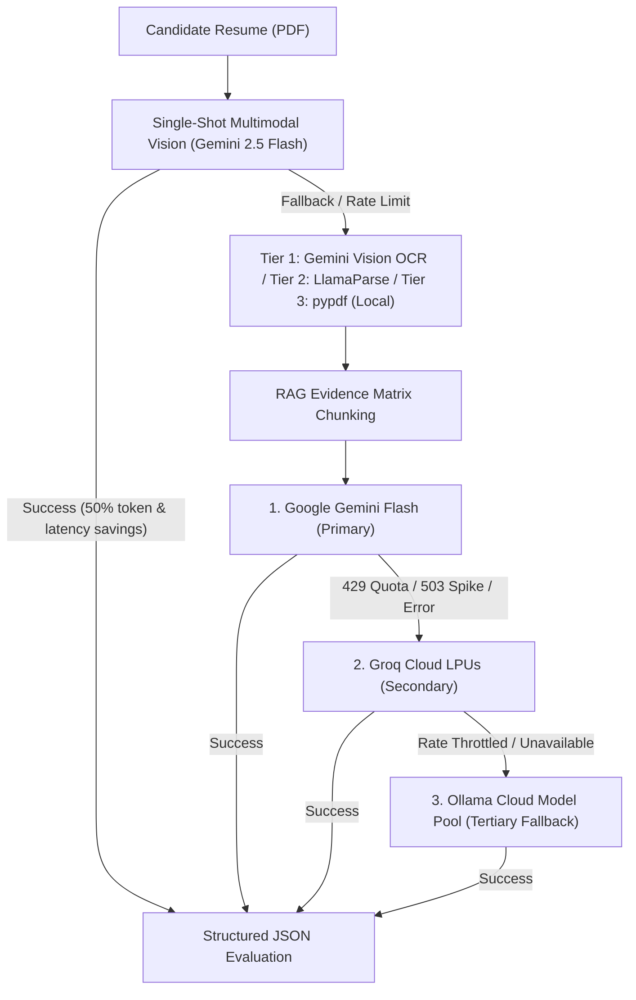

# AI Models, Multi-Provider Cascade & RAG Architecture

Kayatix is powered by real, state-of-the-art Cloud Large Language Models configured with native structured output JSON validation, Retrieval-Augmented Generation (RAG), and calibrated Chain-of-Thought (CoT) reasoning. It never falls back to primitive regex heuristic analyzers for candidate scoring.

---

## 🤖 The Cascade Architecture

Candidate evaluation uses a resilient 3-tier cloud cascade with zero-cost local CPU fallback:

---

## 🧠 Retrieval-Augmented Generation (RAG) Pipeline

Kayatix enhances model precision and eliminates hallucinations by passing candidate profiles through a 3-stage RAG preprocessing pipeline in `app/services/ai_engine.py`:

### Stage 1: Semantic Document Chunking (`segment_candidate_profile`)
Parses unstructured PDF and portfolio text into distinct functional sectors:
* `technical_skills`: Languages, frameworks, databases, cloud tools.
* `professional_experience`: Chronological tenures, titles, company dates.
* `engineering_projects`: Architected systems, scale metrics, deliverables.
* `education_certifications`: Degrees, accredited courses, credentials.
* `candidate_summary`: Header bio, headline, contact information.

### Stage 2: Target Requirement Decomposition (`extract_jd_core_facets`)
Analyzes the target Job Description to isolate:
* `core_requirements`: Non-negotiable mandatory stack competencies.
* `nice_to_haves`: Preferred or bonus secondary skills.
* `responsibilities`: Architectural scope, delivery expectations.

### Stage 3: Grounded Evidence Matrix (`build_rag_augmented_prompt`)
Synthesizes the extracted chunks into a structured evidence benchmark paired with verbatim provenance, ensuring every score is anchored in verified resume evidence.

---

## 🔬 5-Stage Chain-of-Thought (CoT) Prompt Engineering

All models in the cascade are guided by structured system instructions:
1. **Legal Identity Extraction**: Extracts the candidate's actual legal name from the header/contact details, avoiding generic labels like "Candidate Profile".
2. **Tenure & Chronological Audit**: Accurately calculates `estimated_years_experience` based **solely** on commercial software engineering roles. Differentiates software roles from unrelated employment (retail, sales, non-technical support). Flags career gaps > 6 months.
3. **Requirement Alignment & Boolean Reasoning**: Correctly interprets Boolean alternatives (e.g. *"FastAPI or Django"*, *"PostgreSQL or MySQL"*). Fulfilling either fully satisfies the criteria. Differentiates between passive keyword stuffing vs proven production usage.
4. **Calibrated Scoring Rubric (0–100%)**:
   - `85% - 100%`: Exceptional Fit (Exceeds core requirements, proven scale).
   - `70% - 84%`: Strong Hireable Fit (Meets all core criteria, minor gaps only in secondary tools).
   - `50% - 69%`: Moderate Fit / Development Opportunity (Junior tenure for senior role, or missing architectural depth).
   - `0% - 49%`: Low Fit (Critical stack mismatch or unverified claims).
5. **Project-Anchored Interview Questions**: Formulates 5 to 7 high-signal questions directly anchored in the candidate's real projects and targeted at identified stack gaps.

---

## 🔑 Supported Models & Configuration

### 1. Google Gemini (Google AI Studio)
* **API Key Format**: `AIzaSy...` (from [Google AI Studio](https://aistudio.google.com/))
* **Active Models**: `gemini-2.5-flash`, `gemini-2.5-flash-lite`, `gemini-1.5-flash`.
* **Multimodal Evaluation**: Feeds raw PDF bytes directly into `gemini-2.5-flash` in a single pass.

### 2. Groq Cloud (Ultra-Fast LPUs)
* **API Key Format**: `gsk_...` (from [Groq Console](https://console.groq.com/))
* **Active Models**: `llama-3.3-70b-versatile`, `llama-3.1-8b-instant`.

### 3. Ollama Cloud (Model Pool)
* **API Key Format**: `Your Ollama API Key` (from [Ollama Settings](https://ollama.com/settings/keys))
* **Base URL**: `https://ollama.com/v1`
* **Active Models**: `beam`, `gemma4:31b`, `gpt-oss:120b`, `gpt-oss:20b`, `nemotron-3-nano:30b`, `nemotron-3-super`, `nemotron-3-ultra`.

---

## 🚦 Live Status Indicators (Footer Badges)

The status badges in the global footer reflect **live, verified connectivity**:
* 🟢 **Green (`valid`)**: The API key is configured and was successfully tested with a live handshake.
* 🔴 **Red (`invalid`)**: The API key is configured but failed authentication or rate limits.
* ⚪ **Gray (`unconfigured`)**: No API key is currently configured for this provider.

