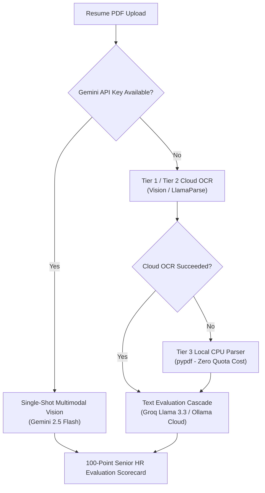

# Candidate Evaluation & AI Assessment Engine

Kayatix evaluates candidate resumes and technical portfolios using a **calibrated Senior Talent Acquisition Director & Principal Bar Raiser framework**. Rather than relying on superficial keyword matching, the engine conducts deep, evidence-anchored evaluations benchmarked strictly against the target Job Description (JD).

---

## 🎯 The Senior HR Evaluation Philosophy

Traditional Applicant Tracking Systems (ATS) rely on simple keyword regex counting. This creates two major problems:
1. **False Positives:** Candidates who copy-paste job description keywords into a "Skills" list receive inflated match scores, even if they have zero practical experience with those technologies.
2. **False Negatives:** Strong engineers who describe their impact using different synonyms or alternative technologies (e.g., PostgreSQL instead of MySQL, or FastAPI instead of Flask) are unfairly rejected.

### How Kayatix Solves This:
Kayatix acts as a **Senior Talent Acquisition Leader** by enforcing three core evaluation tenets:
* **Evidence-Based Verification:** A skill is only considered "verified" if it appears in context within real project descriptions, architecture deliverables, or work experience. Passive keyword lists at the bottom of a CV are discounted.
* **Seniority & Scope Calibration:** A candidate's total relevant commercial years of experience (excluding unrelated retail, customer support, or non-technical roles) is benchmarked against the role's expected level. A 2-year developer applying for a Staff Engineer role is automatically flagged for seniority deficit.
* **STAR Impact Assessment:** The engine rewards candidates who demonstrate **Situation, Task, Action, and Result** with quantifiable business or technical outcomes (e.g., latency reduction, throughput scale, revenue impact, or team mentorship).

---

## 📊 The 100-Point Senior HR Evaluation Framework

The AI engine computes the candidate's **Match Score (0–100%)** using a standardized, weighted 5-pillar rubric:

| Evaluation Pillar | Max Points | Senior HR Assessment Criteria |
| :--- | :---: | :--- |
| **1. Core Competency & Stack Alignment** | **40 pts** | Evaluates mastery of non-negotiable mandatory technologies (P0). Full coverage with proven production track record earns 35–40 pts; partial coverage earns 20–34 pts; fundamental stack mismatch earns 0–14 pts. |
| **2. Seniority & Scope of Ownership** | **25 pts** | Compares verified commercial engineering tenure against the role's level. Meeting or exceeding expected tenure with demonstrated ownership earns 20–25 pts; slight seniority gaps earn 14–19 pts; significant experience deficits earn 5–13 pts. |
| **3. Verifiable Project Impact (STAR)** | **20 pts** | Analyzes quantifiable metrics and production scale. Strong metrics (RPS, latency, cost savings, user base) earn 16–20 pts; qualitative descriptions earn 10–15 pts; passive duty lists with zero metrics earn 0–9 pts. |
| **4. Secondary Tools & System Design Breadth** | **10 pts** | Assesses preferred tools (P1/P2), cloud infrastructure, distributed systems, CI/CD, observability, and containerization. Strong breadth earns 8–10 pts; basic awareness earns 4–7 pts. |
| **5. Career Stability & Trajectory** | **5 pts** | Rewards consistent tenure (average 1.5–3+ years per role) and promotion history (5 pts). Penalizes frequent short stints (<9 months without justification) or unaddressed career gaps (0–3 pts). |

$$\text{Final Match Fit \%} = \text{Core Stack (0–40)} + \text{Seniority (0–25)} + \text{Impact (0–20)} + \text{Secondary (0–10)} + \text{Stability (0–5)}$$

> [!NOTE]
> **Boolean Requirement Logic:** When a job description specifies technical alternatives (e.g., *"FastAPI or Django"*, *"PostgreSQL or MySQL"*, *"AWS or GCP"*), satisfying **either alternative** fully satisfies the core requirement without penalty.

---

## 🏆 Executive Hiring Recommendation Verdicts

Along with the percentage score, every evaluation delivers an unambiguous **Executive Recommendation Verdict** to guide recruiters and hiring managers:

| Verdict Badge | Score Range | Candidate Profile Status | Recommended Action |
| :--- | :---: | :--- | :--- |
| **`[STRONG HIRE]`** | **85% – 100%** | Exceptional fit. Exceeds mandatory requirements, matches or exceeds seniority, and demonstrates proven production scale. | **Fast-track to final interview loop.** Prioritize compensation and team alignment. |
| **`[PROCEED (TECH SCREEN)]`** | **70% – 84%** | Solid candidate. Meets all core technical criteria with relevant tenure; minor ramp-up needed only on secondary tools. | **Advance to Technical Screen.** Focus interview questions on secondary tools or specific system design areas. |
| **`[BORDERLINE (PHONE SCREEN FIRST)]`** | **50% – 69%** | Moderate fit with notable trade-offs. Candidate has foundational skills but lacks seniority depth or key architectural experience. | **Conduct a preliminary 30-min Phone Screen.** Probe identified gaps before committing full interview panel resources. |
| **`[REJECT / NOT RECOMMENDED]`** | **< 50%** | Fundamental mismatch. Critical stack gap, severe experience deficit, or unverifiable claims. | **Decline candidate.** Send polite rejection or archive for different, junior-level openings. |

---

## 📄 Resume PDF Screening Pipeline (`/screener`)

Kayatix supports standard resume PDFs, scanned PDFs, multi-column CVs, and LinkedIn *"Save to PDF"* exports.

### Quota-Protected Multi-Tier Extraction:
1. **Single-Shot Multimodal Vision (Primary Path):** When `GEMINI_API_KEY` is present, raw PDF bytes and the Job Description are processed together in a single multimodal call, cutting latency and token consumption by 50%.
2. **Cloud OCR Fallback:** If multimodal is disabled or rate-limited, document vision extracts markdown preserving multi-column structures and tables.
3. **Local CPU Parser (`pypdf`):** If cloud quotas are exhausted, Kayatix extracts text locally with zero cloud API dependencies and zero extra cost.
4. **Multi-Provider AI Cascade:** In case of API rate limits, evaluation seamlessly cascades:
   $$\text{Google Gemini} \longrightarrow \text{Groq Cloud LPUs} \longrightarrow \text{Ollama Cloud Model Pool}$$

---

## 🌐 Portfolio & Website Extraction Pipeline (`/portfolio`)

Candidates frequently link personal websites, tech blogs, and GitHub repositories. Evaluating web portfolios requires handling modern JavaScript frameworks.

### Single-Page Application (SPA) Support:
Many modern developer portfolios are built with React, Vue, Next.js, or Nuxt.js where raw HTML contains only an empty `

`. Kayatix handles this with a specialized multi-stage extractor:
1. **GitHub Profiles:** Extracts bio, pinned repositories, repository stars, language breakdowns, and commit frequency.
2. **Next.js & Nuxt.js SSR Data:** Automatically extracts and parses embedded `<script id="__NEXT_DATA__">` JSON payloads.
3. **OpenGraph & Schema.org Metadata:** Collects title, description, and author metadata.
4. **Trafilatura Body Extraction:** Strips navigation headers, footers, cookie banners, and boilerplate, preserving core project case studies and technical articles.

> [!TIP]
> **Direct Text Fallback:** If a candidate's portfolio is behind Cloudflare bot protection (HTTP 403), requires authentication, or is a pure WebGL/Canvas app, recruiters can toggle the **Direct Portfolio Text** area to paste project summaries or GitHub READMEs directly.

---

## 🚩 Career Stability & Red Flag Audits

A key differentiator of a Senior HR Leader is identifying risk factors before investing interview team hours. Kayatix automatically flags:

* **Unexplained Timeline Gaps:** Employment gaps greater than 6 months are highlighted with exact dates.
* **High Job-Hopping Velocity:** Candidates with 3+ roles in under 2 years (average tenure < 9 months) are flagged as potential retention risks.
* **Buzzword Stuffing without Execution:** Highlights technologies listed in the skills summary that never appear in any work experience or project deliverables.
* **Title Inflation Disconnect:** Flags senior titles (e.g., *"Lead Architect"* or *"VP of Engineering"*) claimed with less than 2–3 total years of professional experience.

---

## 🎙️ Tailored Interview Question Generation (STAR Method)

For every candidate, the engine generates **5 to 7 high-signal interview questions** customized to their specific profile and gaps. Questions are organized into four strategic categories:

1. **Technical Deep-Dive:** Directly interrogates a complex project or architecture claim made on the resume (e.g., database tuning, concurrency models, or caching layers).
2. **System Design & Architecture:** Tests scale, trade-offs, and failure modes tailored to the technologies the candidate has actually worked with.
3. **Behavioral (STAR Methodology):** Evaluates real-world situations, such as managing technical debt, resolving cross-functional disagreements, or handling critical production outages.
4. **Gap Verification:** Directly probes an unverified skill or missing requirement with a realistic implementation scenario.

### The Interviewer's Rubric:
Each generated question includes two critical fields:
* **Tested Area:** The exact resume claim, technology, or gap being evaluated.
* **Expected Signals & Criteria:** Concrete technical keywords, architectural patterns, and behavioral green flags the interviewer should listen for to objectively score the candidate.

---

## ⚡ Deduplication & Deterministic Caching

* **Deterministic SHA-256 Hash:** Every evaluation computes a SHA-256 hash of `(Candidate Text + JD Text)`.
* **Zero-Latency Repeat Views:** Re-evaluating the same resume against the same JD retrieves the report from the database in `< 15ms`, consuming zero LLM tokens and zero API quotas.
* **Active Provider Cache Invalidation:** If a cached evaluation was produced by a provider that is no longer active, Kayatix automatically re-runs the evaluation using the current active AI cascade.
* **Force Refresh:** Users can force a live re-evaluation at any time using the refresh control.
